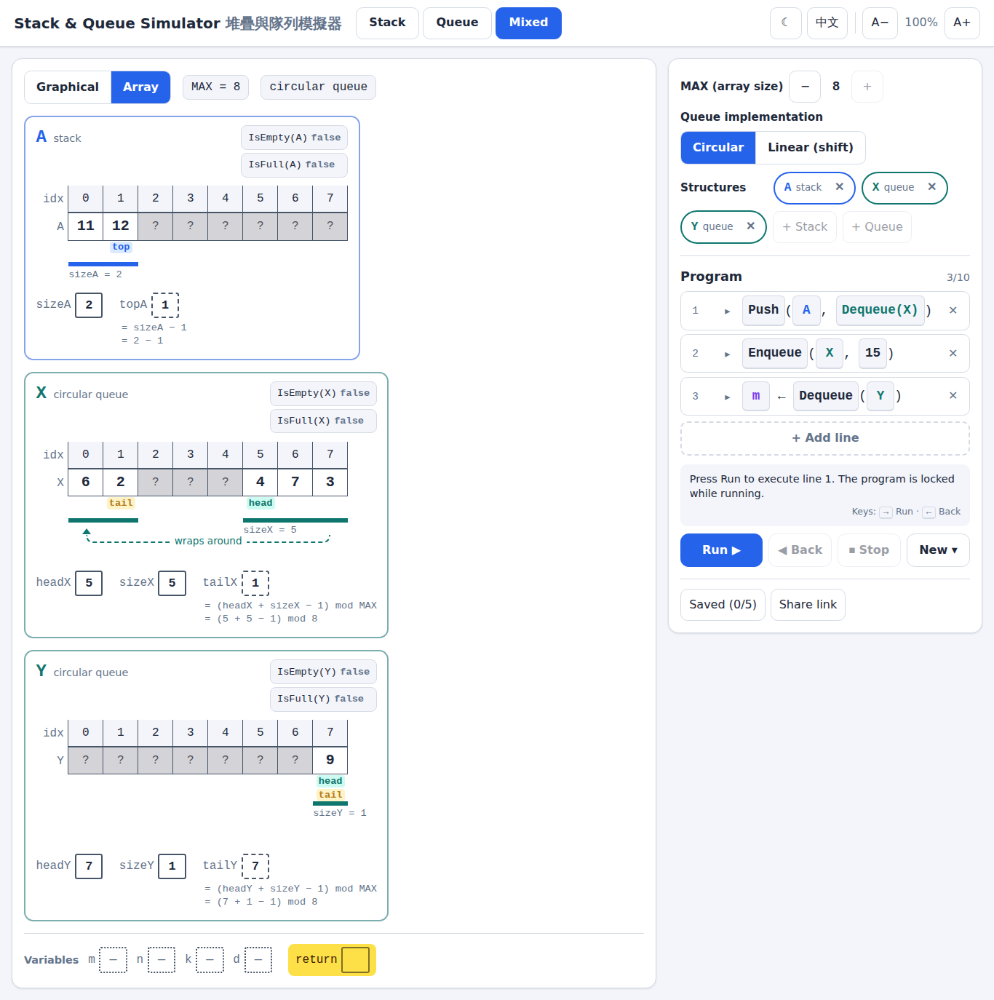

# Stack & Queue Simulator

An interactive self-learning tool for S6 ICT (HKDSE): build a short pseudocode program of
stack and queue operations by clicking, then step through it and watch the structures change,
either as a graphical (logical) view or as an array implementation with its variables.

[**Live Demo**](https://charlotte-lau-hk.github.io/ict-stack-queue-simulation/)

## Features
- **Stack, Queue and Mixed tabs**: up to 3 structures named A/B/C, X/Y/Z or P/Q/R; `MAX` from 4 to 8.
- **Two views of the same state**: graphical, or array with `size`, `head`, derived `top` / `tail`,
  stale (grey) cells and the circular-queue wrap-around.
- **Circular or linear (shift) queue** to compare the two implementations.
- **Click-only program editor** (up to 10 lines): `Push(A, 3)`, `m ← Pop(A)`, `Enqueue(X, m)`,
  `Push(B, Pop(A))`.
- **Step by step**: Run one line, or expand a line to step through the array-level pseudocode
  inside the function. Back one step, Stop to edit.
- **Runtime errors** for overflow, underflow and unassigned variables, with a hint to check
  `IsFull` / `IsEmpty`.
- **Random error-free programs** for students to dry run.
- **Editable starting state**: before Run, click to add, change or remove items and to give `m`, `n`, `k`, `d` a starting value, e.g. to match a DSE question.
- English / 繁體中文, light / dark theme, zoom for projectors, large touch targets.
- Saves up to 5 programs in the browser; share a demo as a link.

## How to Use
Open `index.html` in a browser — a single file with no dependencies; works offline.

## Development
`npm install` then `npm test` runs the Playwright checks in `tests/` (dev only).
